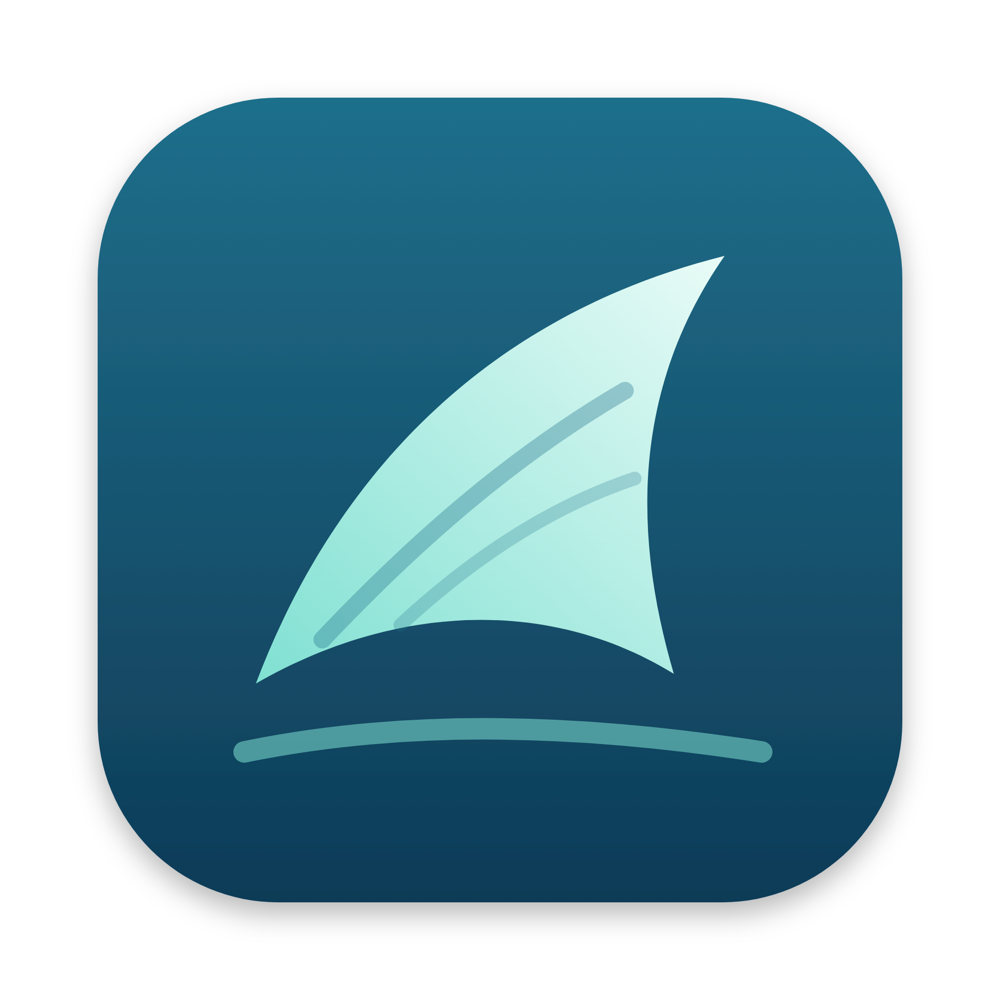

English · [简体中文](README.zh-CN.md)



# Stowfin 轻扫

**See what uses your Mac's storage. Review before you clean.**

Stowfin is a local macOS storage browser and manual cleanup tool, licensed under MIT. Explore usage by application or folder, review installers, cache and personal files separately, then choose what to move to Trash.

**1.8.6 Beta · build 21.** The app displays **Stowfin** in English and **轻扫** in Simplified Chinese. This Beta uses a local signing certificate and ships **without Apple notarization or a Developer ID signature**. macOS may ask you to verify the app on first launch. Follow the [installation guide](docs/INSTALL.en.md).

[Download for Apple Silicon](https://github.com/FishyJ10312/Stowfin/releases/download/v1.8.6-beta/Stowfin-1.8.6-beta-arm64.zip) · [Beta release](https://github.com/FishyJ10312/Stowfin/releases/tag/v1.8.6-beta) · [Report an issue](https://github.com/FishyJ10312/Stowfin/issues/new?template=bug_report_en.md)

**Media and projects are unselected by default.** You can add them manually, including from file details in Storage. Moving them to Trash requires a second confirmation.

## Cleanup workflow

- Open cleanup from an application or folder in Storage and return to the same position. Chosen analysis folders stay in scope after relaunch.
- The combined scan updates both lists. Stop a cleanup rescan to keep the previous completed results and selections. Known small caches are grouped for review.
- Review all checked files or just the current scope. Use **Add to review** in single-file details without leaving Storage.
- History distinguishes unreadable Trash, disconnected volumes and confirmed missing files. Recheck after access returns.

## Screenshots and cleanup demo

### Stowfin 1.8.6 Beta · English


**Select → review → move to Trash → restore in History.** Both generated files were restored and verified against their original contents.


[Download English MP4](https://github.com/FishyJ10312/Stowfin/releases/download/v1.8.6-beta/cleanup-restore-en.mp4) · [中文演示](README.zh-CN.md#清理与恢复演示) · [Both galleries and demo notes](docs/DEMO.md)

Each step comes from the actual app running with generated files on a temporary volume. The walkthrough uses edited step timing. No personal names or paths appear.

<details>
<summary>Media and project selection, batch restore, and the Chinese interface</summary>

Adding recommendations leaves the demo video and project unselected.


</details>

## Review-first cleanup

1. Install at a fixed location following the [installation guide](docs/INSTALL.en.md). **Scan common locations** checks Downloads, caches and logs. The file threshold starts at 1 MB, with known smaller caches included in groups.
2. If a location is unread, choose a folder, open System Settings or recheck in the access assistant. Grant system permissions yourself; Stowfin verifies actual reads.
3. Read the classification and cleanup impact, then make your selection. To add a single file from Storage, open its details and choose **Add to review**.
4. Choose **Review all** or review the current scope. Remove individual items or groups as needed. Manual-review content requires a second confirmation.
5. Files move to Trash. Restore eligible items to their original locations from History.

| Section | What it means | Selection |
| --- | --- | --- |
| Red · Recommended | Candidates identified by known rules, such as older installers and some rebuildable download cache | Add recommendations within the current scope, then review |
| Blue · Choose manually | Content whose purpose and cleanup impact need your judgment | Select manually |
| Purple · Manual review | Media, photos, projects, source code and unidentified content | **Unselected by default.** Select individually, by group or with Select All, then confirm again |

Classification is a review aid. It does not establish that a file is no longer needed. You decide whether a project, proxy or creative asset is still in use.

Cleanup moves files to Trash; Stowfin never empties Trash. **Moved bytes are not the same as immediately freed disk space.** Restore requires the corresponding files to remain in Trash and pass verification. It is not a backup.

Related applications may be asked to quit normally. Save your work when prompted; items still in use, changed or unreadable are skipped.

## Features

- **Storage browser:** application totals, folder navigation and breadcrumbs, parent/back controls, paginated lists, full-index search and a space map.
- **Complete cleanup list:** purpose-based groups, classification evidence, impact descriptions and previews. Adding recommendations never automatically selects media or projects.
- **Access assistant:** identifies unread locations, guides you to the required macOS permission and performs a real read after you return.
- **Incremental scans:** updates changed areas and continues incomplete folders.
- **Operation journal and restore:** logs each file operation, reconciles interrupted batches on restart and restores without overwriting existing destinations.
- **Tools:** DaVinci proxy/cache browsing, duplicate checks, verified archive copies, application/private-data review, user LaunchAgents, storage growth and optional memory monitoring.

## Languages

The app follows the system language by default, with English as the fallback for unsupported languages. Use the language menu at the top of the window to choose **System default**, **简体中文** or **English**. Your preference survives relaunch.

Switching language preserves selections and stored records. File names and paths remain verbatim; the interface does not translate or rename your files. Language changes are disabled while reviewing a cleanup or running file operations. macOS-owned dialogs follow macOS's language settings.

## Requirements and verification

| Item | Current status |
| --- | --- |
| Hardware | Apple Silicon / arm64; no Intel download in this release |
| macOS | Built for macOS 14 or later; actual device validation on macOS 27.2 |
| Signing | Persistent local certificate and Hardened Runtime; **no Developer ID or Apple notarization** |
| Checks | 126 checks focused on localization, classification, scope and review. Localization covers 830 entries. |
| Native verification | English and Chinese display names, default selection and manual confirmation tested with generated files |
| Still pending | First launch on another Mac with default Gatekeeper, actual macOS 14 hardware, more file systems and physical external-disk disconnection tests |

This is a **Pre-release** for feedback. Try a disposable folder first. See the [release and validation notes](docs/RELEASE_1.8.6_BETA.md).

## Installation and privacy

- [Installation and permissions](docs/INSTALL.en.md): first launch, Full Disk Access, language selection, upgrades and restore.
- [Privacy](docs/PRIVACY.en.md): local metadata, operation history, content checksums and preferences.
- Scans and cleanup run locally. The app does not upload your files, paths or cleanup history.
- Release assets include `SHA256SUMS.txt` for download integrity checks. A checksum is not Apple notarization or a security certification.

## Build from source

Install Apple's Command Line Tools, then run from the repository root:

```sh
zsh build.sh .build/local-output
```

The app is written to `.build/local-output/轻扫.app`. It uses system Swift, SQLite, CryptoKit, AVFoundation and ServiceManagement, without downloading third-party packages. The script creates or reuses a local signing identity on your Mac. A locally rebuilt app has a different identity from the release and may require fresh macOS permissions.

Run the checks:

```sh
zsh check.sh
```

Tests generate disposable files. Some really move them to Trash, restore them and terminate dedicated test children. Native UI walkthroughs are performed separately.

`check.sh` runs every check group before summarising, exits non-zero if any group failed, and keeps each group's output in `.build/check-logs/`. Afterwards it removes only the fixture directories this run created (`/Users/Shared/qingsweep-*` and `testdata-*` in the repository) and leaves directories that existed before untouched; set `STOWFIN_KEEP_FIXTURES=1` to keep them for debugging. Checks that use the Trash need to read `~/.Trash`, so give the terminal or program running them Full Disk Access; without it those groups fail because the app correctly refuses to move files. Localization coverage checks text formatting, plural counts, verbatim names/paths, preference persistence, legacy identifiers and English search of older indexed titles.

## Feedback and license

Please include your app version, macOS version, chip and reproduction steps in an [issue](https://github.com/FishyJ10312/Stowfin/issues/new?template=bug_report_en.md). Redact personal names and paths in screenshots. Do not attach complete scan databases, cleanup history, media or projects.

[MIT License](LICENSE) · [Third-party attribution](NOTICE.md) · [1.8.6 release notes](docs/RELEASE_1.8.6_BETA.md) · [1.8.4 launch copy](docs/PROMO.en.md)

Stowfin is an independent project and is not affiliated with Apple or MacPaw.
