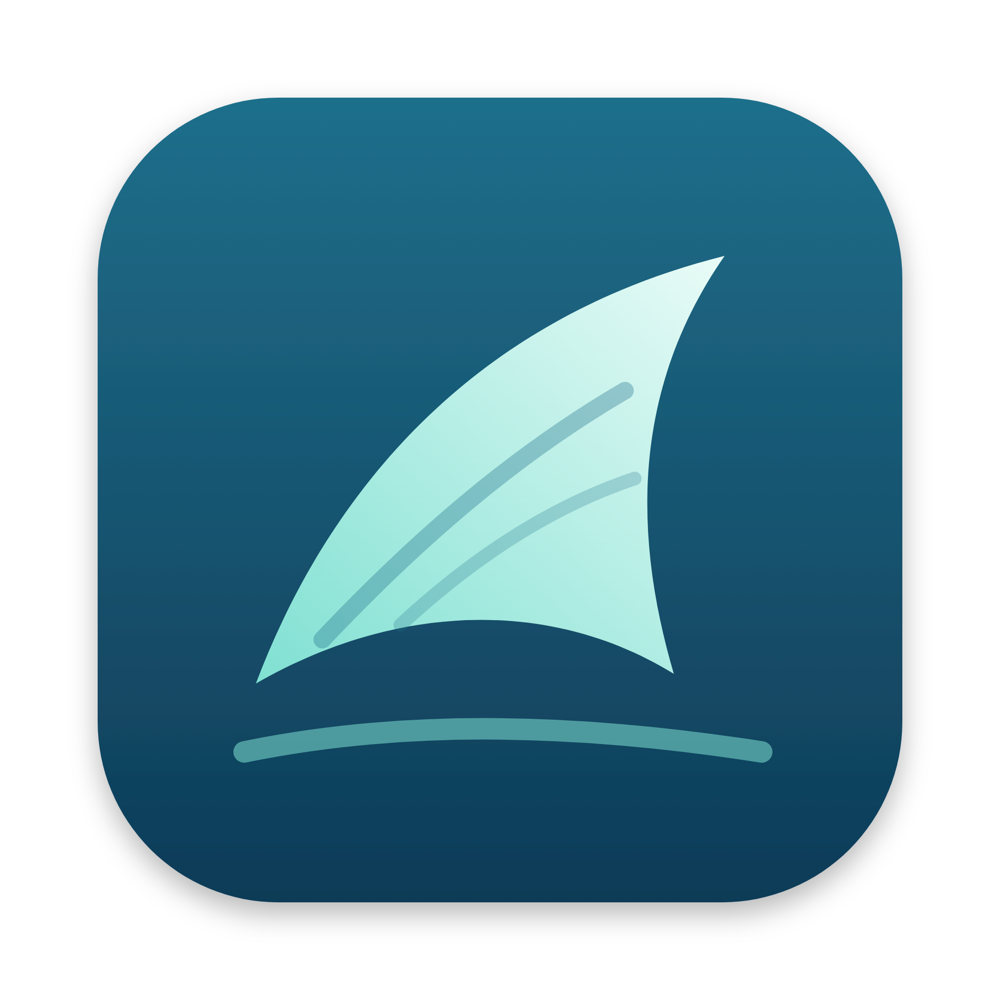

[English](README.md) · 简体中文



# 轻扫 Stowfin

**看清 Mac 空间占用，确认以后再清理。**

轻扫是一款本地运行的 macOS 磁盘分析与清理工具。可以按应用或文件夹查看占用，把旧安装包、缓存、日志与个人文件分开，再决定哪些内容移到废纸篓。

**1.8.7 Beta（构建 22）暂未经过 Apple 公证。** 应用的英文名为 **Stowfin**，简体中文名为**轻扫**。安装包使用本机签名证书，未使用 Apple Developer ID 签名。首次启动可能出现开发者验证提示。[安装与授权说明](docs/INSTALL.zh-CN.md)

[下载 Apple 芯片版本](https://github.com/FishyJ10312/Stowfin/releases/download/v1.8.7-beta/Stowfin-1.8.7-beta-arm64.zip) · [Beta 发布页](https://github.com/FishyJ10312/Stowfin/releases/tag/v1.8.7-beta) · [反馈问题](https://github.com/FishyJ10312/Stowfin/issues/new?template=bug_report.md)

**素材和项目默认不勾选。** 可以主动勾选，也可以从空间分析的单文件详情加入待复核。移到废纸篓前需要二次确认。

## 扫描、复核与恢复

- 从应用或文件夹进入清理会沿用分析范围，并能返回原浏览位置。重启后保留自选分析范围。
- 「扫描空间与清理项」同时更新两页。停止清理复扫会保留上一次完成的清单和已有勾选。已识别的小缓存按组汇总。
- 主按钮复核全部已选，也可只复核当前范围。在空间分析的单文件详情中，可点「加入待复核」。
- 清理记录区分废纸篓暂时无法读取、磁盘未连接和已确认缺失。访问恢复后可重新检查。

## 清理与恢复演示

### 轻扫 1.8.6 Beta · 简体中文


**全选推荐项 → 复核 → 移到废纸篓 → 从清理记录批次恢复。** 两个演示文件均已恢复，内容与原文件一致。


[下载中文 MP4](https://github.com/FishyJ10312/Stowfin/releases/download/v1.8.6-beta/cleanup-restore-zh-CN.mp4) · [English demo](README.md#screenshots-and-cleanup-demo) · [双语截图与演示说明](docs/DEMO.md)

画面来自应用在临时磁盘上的实际操作，按步骤整理了播放时长。所有文件均为演示生成，画面不含个人文件名和路径。

<details>
<summary>素材与项目的默认选择、批次恢复和英文界面</summary>

全选推荐项后，演示视频与项目仍未勾选。


</details>

## 怎么用

1. 按[安装说明](docs/INSTALL.zh-CN.md)放到固定位置。「扫描常用位置」检查下载、缓存和日志。常规文件从 1 MB 起，符合规则的小缓存也会按组列出。
2. 未读取时使用访问助手选择文件夹、前往系统设置或重新检查。系统授权由你完成，应用会实际试读。
3. 查看分类、占用与清理影响，选择需要处理的文件。也可从空间分析的文件详情加入待复核。
4. 选择复核全部或只复核当前范围，可取消整组或单项。需自行确认的内容还会经过二次确认。
5. 文件移到废纸篓后，可在「清理记录」按批次恢复到原位置。

| 分类 | 含义 | 选择方式 |
| --- | --- | --- |
| 红色 · 推荐清理 | 已识别规则下的旧安装包、部分可重建缓存等候选 | 点击添加建议项后，再复核清单 |
| 蓝色 · 可自行选择 | 需要结合用途、清理影响决定的内容 | 手动选择 |
| 紫色 · 需自行确认 | 素材、照片、项目、源代码及用途不明确的文件 | **默认不勾选**；支持手动单选、全选与按组选择，二次确认后可移到废纸篓 |

分类是核对线索，不能证明文件已经没有用途。项目或代理文件是否仍被使用，需要你结合自己的工作判断。

## 语言

同一个安装包包含 English 与简体中文。默认跟随系统语言，也可以在窗口顶部的语言菜单切换；选择会在重启后保留。素材、项目、路径、索引和清理记录的身份不随语言切换改变。

## 可以做什么

- **空间分析**：按应用汇总程序、数据、缓存和日志；保留文件夹浏览、返回上级、分页、全索引搜索与空间图。
- **完整清理清单**：按用途分类，查看依据、影响和预览；素材与项目不会被建议项自动选中。
- **文件访问助手**：区分未读取的位置，按需引导授权，返回后重新试读。
- **增量扫描**：更新发生变化的范围；未完成目录保留接续队列。
- **操作日志与恢复**：逐项保存操作意图和结果；重启核对中断批次，支持批次恢复，不覆盖原位置已有文件。
- **工具**：达芬奇代理与缓存浏览、重复文件检查、校验后归档、应用与私有数据核对、用户启动项和本机增长记录。

清理只移到废纸篓，应用不会清空废纸篓。**移入废纸篓的容量不等于已经释放的磁盘空间。** 恢复依赖文件仍在废纸篓且通过核验，不能替代备份。

清理过程中，应用可能尝试正常退出相关软件。保存窗口需要你处理；仍被占用、身份变化或无法读取的项目会跳过。

## 系统与测试范围

| 项目 | 当前状态 |
| --- | --- |
| 芯片 | Apple Silicon（arm64）；本版不提供 Intel 安装包 |
| 系统 | 编译最低版本 macOS 14；实际验收环境为 macOS 27.2 |
| 签名 | 本机自签名，启用 Hardened Runtime；**无 Developer ID、无 Apple 公证** |
| 本机检查 | 全量 858 项自动检查通过（23 组），包含 126 项中断与恢复、34 项范围与复核检查，英文目录验证 834 条词条，另验证了 30,017 文件的完整清单 |
| 原生界面 | 界面与 1.8.6 相同。核对了构建产物的版本、中英文显示名和签名；新增的安装包与 Go 缓存规则由自动检查用临时文件覆盖 |
| 仍待验证 | 另一台 Mac 的默认 Gatekeeper 下载与首次启动、macOS 14 实机、真实外置盘拔插及不同文件系统 |

这是用于收集反馈的 **Pre-release**。可以用临时文件夹试用扫描、手动选择、清理与恢复。[本版更新与验收记录](docs/RELEASE_1.8.7_BETA.md)

## 安装、权限与隐私

- [安装授权说明](docs/INSTALL.zh-CN.md)：首次启动、完全磁盘访问、升级与恢复。
- [隐私说明](docs/PRIVACY.zh-CN.md)：本机索引、操作记录与校验信息的保存方式。
- 扫描和清理在本机执行；应用不上传文件、扫描路径或清理记录。
- 发布附件包含 `SHA256SUMS.txt`，可用于核对下载文件完整性；校验值不代表 Apple 公证或安全认证。

## 从源码构建

安装 Apple Command Line Tools，在仓库根目录执行：

```sh
zsh build.sh .build/local-output
```

产物位于 `.build/local-output/轻扫.app`。使用系统 Swift、SQLite、CryptoKit、AVFoundation 和 ServiceManagement，无需下载第三方包。构建脚本会在本机生成或复用本机签名身份；从源码构建得到的签名与发布包不同，系统权限可能需要重新确认。

运行检查：

```sh
zsh check.sh
```

检查会创建临时文件，部分用例会真实移入废纸篓、恢复，并终止专用测试子进程。原生界面走查是另行执行的验证，不包含在自动检查数量里。

`check.sh` 会跑完全部检查组再汇总，任一组失败时以非零状态退出，各组输出保存在 `.build/check-logs/`。运行结束后只删除本次运行新建的测试夹具（`/Users/Shared/qingsweep-*` 与仓库内 `testdata-*`），运行前已存在的目录保持不动；需要保留夹具排查问题时设置 `STOWFIN_KEEP_FIXTURES=1`。

涉及废纸篓的检查需要读取 `~/.Trash`，请给运行检查的终端或程序开启「完全磁盘访问」，否则这些组会因应用正确拒绝移动而失败。

## 反馈与项目资料

欢迎反馈安装失败、权限问题、分类不准确、扫描遗漏、清理与恢复结果。提交 [Issue](https://github.com/FishyJ10312/Stowfin/issues/new?template=bug_report.md) 时请写明系统版本、芯片、版本号与复现步骤；截图遮住个人文件名和路径。

[1.8.7 Beta 更新说明](docs/RELEASE_1.8.7_BETA.md) · [1.8.4 宣传文案](docs/PROMO.zh-CN.md) · [致谢与许可状态](NOTICE.md)

本项目原创代码与文档采用 [MIT License](LICENSE)，第三方参考署名见 [NOTICE.md](NOTICE.md)。
